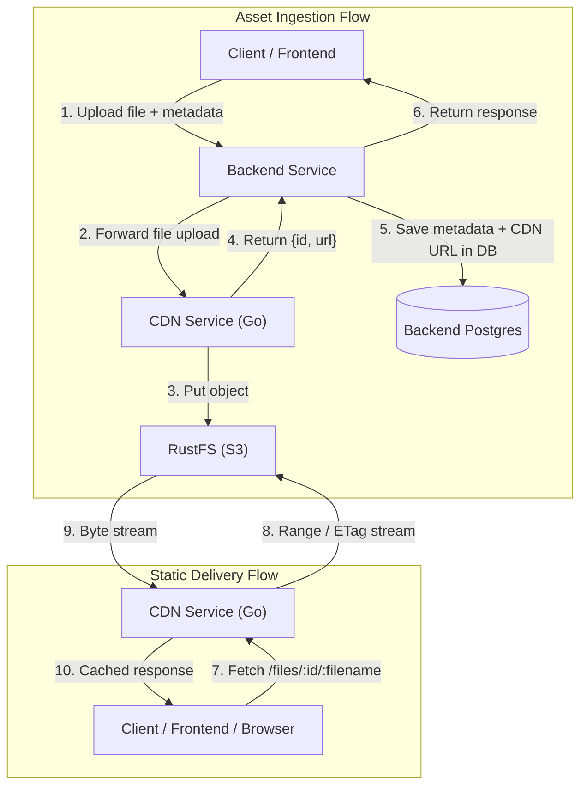

# CDN Service

[](https://golang.org)
[](https://github.com/rustfs)
[](/swagger/)

Lightweight, high-performance static asset CDN written in Go. Delivers video (`.mp4`), audio (`.mp3`, `.wav`, `.ogg`, etc.), code/scripts (`.js`), and documents (`.pdf`, text, images) directly from S3-compatible storage ([RustFS](https://github.com/rustfs) / MinIO).

> [!NOTE]
> Asset metadata (ownership, tags, topics, user relations) is managed externally in the **Backend**. The CDN acts purely as a content delivery engine: receiving binary streams, assigning UUIDs, storing to S3, and streaming with byte-range support and immutable caching.

---

## Architecture



---

## Supported File Types

| Category | Extensions | MIME Types |
|---|---|---|
| **Video** | `.mp4` | `video/mp4` |
| **Audio** | `.mp3`, `.wav`, `.ogg`, `.m4a`, `.aac`, `.flac`, `.weba`, `.opus` | `audio/mpeg`, `audio/wav`, `audio/ogg`, `audio/mp4`, `audio/aac`, `audio/flac`, `audio/webm`, `audio/opus` |
| **Code / Scripts** | `.js`, `.mjs`, `.cjs` | `application/javascript`, `text/javascript` |
| **PDF** | `.pdf` | `application/pdf` |
| **Text** | `.txt`, `.md`, `.csv`, `.json`, `.xml` | `text/plain`, `text/markdown`, `text/csv`, `application/json`, `application/xml` |
| **Images** | `.png`, `.jpg`, `.jpeg`, `.webp`, `.gif`, `.svg`, `.ico` | `image/png`, `image/jpeg`, `image/webp`, `image/gif`, `image/svg+xml`, `image/x-icon` |

---

## API Endpoints

### Interactive Swagger UI
- **Swagger UI**: `http://localhost:8080/swagger/` (aliases: `/docs`, `/swagger`)
- **Raw OpenAPI 3.0 Spec**: `http://localhost:8080/swagger/openapi.yaml`

---

### 1. Upload File(s)
Upload single file using `file`, or multiple files using `files` (`POST /api/v1/files`, aliases: `POST /api/v1/assets`, `POST /upload`).

```bash
# Single upload
curl -X POST http://localhost:8080/api/v1/files \
  -F "file=@video.mp4"

# Batch upload
curl -X POST http://localhost:8080/api/v1/files \
  -F "files=@video.mp4" \
  -F "files=@bundle.js"
```

**Single Upload Response (`201 Created`):**
```json
{
  "id": "634d4145-b73a-496d-be30-f7d8b41e5fb5",
  "filename": "video.mp4",
  "url": "http://localhost:8080/files/634d4145-b73a-496d-be30-f7d8b41e5fb5/video.mp4"
}
```

**Batch Upload Response (`201 Created`):**
```json
{
  "ids": [
    "b91b400a-abfe-4ddf-858b-9aa48838b87e",
    "e553b62d-a798-4396-8610-82411bf96cef"
  ],
  "files": [
    {
      "id": "b91b400a-abfe-4ddf-858b-9aa48838b87e",
      "filename": "video.mp4",
      "content_type": "video/mp4",
      "file_size": 16420120,
      "url": "http://localhost:8080/files/b91b400a-abfe-4ddf-858b-9aa48838b87e/video.mp4"
    },
    {
      "id": "e553b62d-a798-4396-8610-82411bf96cef",
      "filename": "bundle.js",
      "content_type": "application/javascript",
      "file_size": 15200,
      "url": "http://localhost:8080/files/e553b62d-a798-4396-8610-82411bf96cef/bundle.js"
    }
  ]
}
```

---

### 2. Deliver Static File
Streams static files directly with caching and byte-range seek support.

```bash
# Fetch full file
curl -i http://localhost:8080/files/634d4145-b73a-496d-be30-f7d8b41e5fb5/video.mp4

# Fetch with byte range (video seeking)
curl -i -H "Range: bytes=0-1048575" http://localhost:8080/files/634d4145-b73a-496d-be30-f7d8b41e5fb5

# Cache validation
curl -i -H 'If-None-Match: "79af441c3939143d0019a6a23d350803"' http://localhost:8080/files/634d4145-b73a-496d-be30-f7d8b41e5fb5
```

**CDN Headers:**
- `Cache-Control: public, max-age=31536000, immutable`
- `Accept-Ranges: bytes`
- `ETag: "<md5/sha>"`
- Returns `304 Not Modified` on valid cache match
- Returns `206 Partial Content` on byte-range requests

---

### 3. Replace / Update File
Replace underlying content for an existing ID (`PUT /api/v1/files/{id}`, alias: `PUT /files/{id}`):

```bash
curl -X PUT http://localhost:8080/api/v1/files/634d4145-b73a-496d-be30-f7d8b41e5fb5 \
  -F "file=@updated-video.mp4"
```

---

### 4. Delete File
Deletes the object and its prefixes from S3 (`DELETE /api/v1/files/{id}`, alias: `DELETE /files/{id}`):

```bash
curl -i -X DELETE http://localhost:8080/api/v1/files/634d4145-b73a-496d-be30-f7d8b41e5fb5
# Returns 204 No Content
```

---

### 5. Health Check
```bash
curl http://localhost:8080/healthz
# Returns {"s3":true,"status":"healthy"}
```

---

## Configuration

All configuration is managed via environment variables (see `.env.example`):

| Variable | Default | Description |
|---|---|---|
| `PORT` | `8080` | HTTP listening port |
| `CDN_BASE_URL` | `http://localhost:8080` | Base URL used to construct returned `url` static links |
| `MAX_UPLOAD_SIZE_MB` | `500` | Maximum allowed upload size in megabytes |
| `S3_ENDPOINT` | `http://localhost:9000` | RustFS / S3 endpoint URL |
| `S3_REGION` | `us-east-1` | S3 signing region |
| `S3_BUCKET` | `braingain` | Target storage bucket (auto-created if missing) |
| `S3_ACCESS_KEY_ID` | `braingain` | S3 access key |
| `S3_SECRET_ACCESS_KEY` | `braingain-secret` | S3 secret key |
| `S3_USE_PATH_STYLE` | `true` | Required `true` for RustFS / MinIO |

---

## Development & Testing

### 1. Start Storage Infra
Start RustFS locally via `docker-compose.dev.yaml` (or from `../Infra/rustfs/docker-compose.yml`):
```bash
docker compose -f docker-compose.dev.yaml up -d
```

### 2. Run CDN Server
```bash
go run ./cmd/server
```

### 3. Run Unit Tests
```bash
go test -v ./...
```

---

## CI / CD

Configured identical to `../Frontend`:
- `version.txt`: Semantic version tracking (`0.0.5`)
- `renovate.json`: Automated dependency upgrades with automerge for patch/minor updates
- `.github/workflows/pr-bump-version.yaml`: Automatic version bumps for Renovate PRs
- `.github/workflows/release-and-build.yaml`: Container image build and GitHub release pipeline
- `Dockerfile`: Multi-stage Go scratch/alpine build with OpenContainer labels (`VERSION`, `GIT_COMMIT`)
